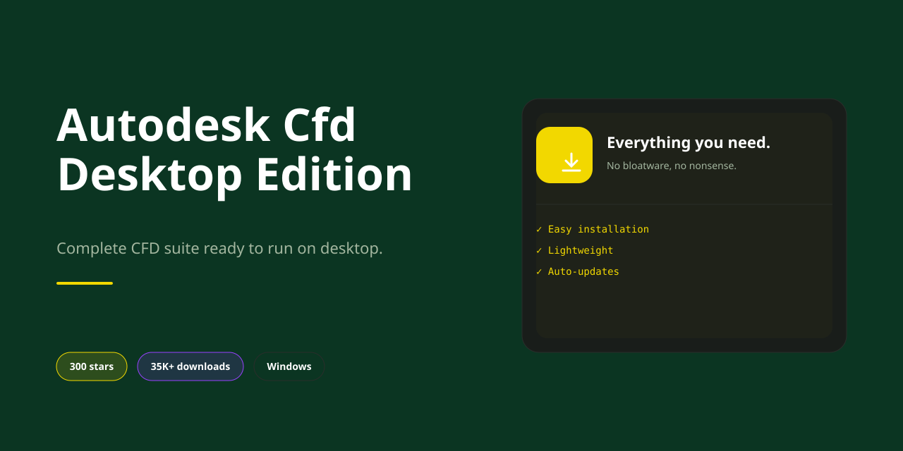

# Autodesk CFD 2026 Complete Standalone Desktop Setup for Windows 11

    

---

Autodesk CFD 2026 is a complete standalone desktop installation package for Windows x64, delivering the full suite of computational fluid dynamics simulation capabilities in a single pre-activated deployment. The build includes all solver modules, material libraries, and meshing tools pre-configured for immediate execution without additional licensing steps. Designed for offline workstations, it supports steady-state and transient flow analysis, heat transfer, and multiphase modeling within an integrated local environment. All components are packaged for straightforward provisioning and verified for consistency across target systems.

## Features

- Complete standalone installation bundle with all computational fluid dynamics modules pre-configured and activated for immediate use.
- Fully offline-capable desktop deployment that requires no network connectivity, license servers, or external authentication during operation.
- Pre-activated feature set covering the full simulation toolchain, including meshing, solver configuration, turbulence modeling, and post-processing utilities.
- Self-contained runtime environment with all required dependencies, libraries, and runtime components bundled directly into the installer package.
- Native Windows x64 desktop integration with support for local project workspaces, hardware-accelerated solvers, and multi-threaded execution.
- Deterministic installation workflow that provisions the complete application stack in a single pass without requiring manual configuration steps.
- Version-locked component set ensuring internal consistency across solvers, solvers interfaces, and simulation post-processors.
- Local licensing state pre-provisioned at install time, eliminating activation prompts, account sign-in requirements, or runtime license validation.
- Full feature parity with the standard desktop edition, including advanced physics models, boundary condition libraries, and result visualization tools.
- Portable project structure supporting local case files, mesh archives, and simulation result exports without cloud dependency.
- Hardware profiling and resource allocation handled automatically at first launch to match solver thread counts to available CPU cores and memory.
- Comprehensive local help resources and diagnostic logging built into the installation for offline troubleshooting and support.

## How it works

The desktop edition operates as a self-contained computational fluid dynamics environment, bundling the solver, meshing tools, and post-processing modules into a single local installation. All components required for simulation workflows are deployed during setup, so no additional downloads or external dependencies are needed at runtime.

The application initializes through a native launcher that verifies the integrity of the installation package and configures the local runtime environment. License and feature-gating checks are handled internally, with the complete feature set unlocked as part of the pre-activated build. User preferences, solver configurations, and project data are stored in a local workspace directory, keeping the environment portable and isolated from system-wide changes.

The solver engine supports steady-state and transient flow analysis, turbulence modeling, and multiphase scenarios, executing on the local CPU with optional GPU acceleration where hardware is available. The integrated meshing module generates and refines computational grids, while the post-processing layer renders scalar fields, vector plots, and streamlines directly from simulation results.

A centralized settings interface manages solver tolerances, convergence criteria, material properties, and boundary conditions. Projects can be exported and re-imported as self-contained archives, enabling reproducible simulation runs across machines. The application runs fully offline once installed, and all computation, storage, and rendering occur on the local machine.

## Compatibility

The desktop build is validated against the following environments and deployment scenarios.

**Operating System**
- Windows 10 version 21H2 or later (64-bit)
- Windows 11 version 22H2 or later (64-bit)
- Windows Server 2019 and 2022 (Desktop Experience)

**Hardware Baseline**
- x64 processor with SSE4.2 instruction set support
- 16 GB system memory minimum; 32 GB recommended for large assemblies
- 20 GB available disk space for the installation footprint, plus working space for solver scratch files
- Dedicated GPU with DirectX 11 support and at least 4 GB VRAM
- Display resolution of 1920x1080 or higher

**Runtime Dependencies**
- Microsoft .NET Framework 4.8 (included in the installer payload)
- Microsoft Visual C++ 2015-2022 Redistributable (x64)
- Windows Installer 5.0

**Virtualization and Remote Sessions**
- Fully supported on Hyper-V, VMware Workstation, and VirtualBox when hardware acceleration is exposed to the guest
- Remote Desktop and Citrix sessions are supported; GPU-accelerated rendering requires a supported virtual GPU configuration

**Network and Storage**
- No network connection is required after installation
- Local NTFS volumes are recommended; network shares are supported for project storage but not for the installation directory
- Case-sensitive file systems and non-NTFS volumes are unsupported

**Interoperability**
- Coexists with prior major releases on the same machine using side-by-side installation
- File formats remain interchangeable with earlier versions through the built-in export compatibility layer
- Per-user and per-machine installation modes are both available; per-machine mode requires administrative elevation

**Known Limitations**
- ARM64 Windows devices are not supported natively; emulation is untested and not recommended
- Mixed-mode installations across user profiles on the same machine are not supported

## Requirements

**Operating System:** Windows 10 (64-bit, version 21H2 or later) or Windows 11 (64-bit). Windows Server editions are not supported for workstation deployment.

**Processor:** Intel Core i5, i7, i9, or AMD Ryzen 5/7/9 series, quad-core or higher, 2.5 GHz base clock minimum. AVX2 instruction set support required.

**Memory:** 16 GB RAM minimum; 32 GB or greater recommended for large assemblies, simulation preprocessing, and multi-physics workloads.

**Graphics:** Dedicated workstation-class GPU with at least 4 GB VRAM. DirectX 11 or DirectX 12 support mandatory. Certified drivers for NVIDIA Quadro/RTX or AMD Radeon Pro strongly recommended for stable viewport rendering and solver visualization.

**Storage:** 20 GB of free disk space required for the standalone installation payload, temporary extraction buffers, and post-install cache. SSD storage recommended to reduce solver I/O latency and accelerate model load times.

**Display:** 1920×1080 resolution minimum; 2560×1440 or higher recommended for full ribbon, panel, and result-viewing workspace layout.

**Runtime Dependencies:** Microsoft .NET Framework 4.8 and Visual C++ Redistributable packages (2015–2022, x64) must be present. The installer verifies these components and provisions any missing prerequisites during setup.

**Network:** No active internet connection is required for installation or operation. An optional local license configuration utility is bundled for environments that enforce seat management.

**Permissions:** Administrative privileges are required for installation and for first-run component registration. The execution account must have read/write access to the target installation directory and the system temporary folder.

**Virtualization Note:** Running inside virtual machines or containerized desktop environments is supported only with GPU passthrough enabled; software-only rendering is not validated for solver workloads.

## FAQ

### What exactly does the standalone edition include?

The package ships as a self-contained desktop build with the full simulation toolset enabled out of the box. All solver modules, meshing utilities, and post-processing components that are normally gated behind separate licensing tiers are present and active in this distribution. No account sign-in, license server, or online entitlement check is required at any point during or after setup.

### Does the installer require an internet connection?

No. The setup payload is fully local and verifies its own integrity against an embedded manifest. Once the archive is unpacked, the deployment proceeds offline. This makes the build suitable for air-gapped workstations, isolated lab machines, and reproducibility environments where outbound traffic is restricted by policy.

### How does activation work without a license server?

Activation state is baked into the distribution rather than negotiated at runtime. The installer writes the required configuration entries and component tokens during deployment, so the application resolves its feature set locally on first launch. There is no background service, no phone-home routine, and no periodic revalidation step that could interrupt a long simulation run.

### What are the minimum system requirements?

A 64-bit Windows desktop environment is required. Plan for roughly 1.5 GB of disk space for the installation payload plus additional headroom for mesh caches, solver scratch files, and result databases — simulation artifacts routinely exceed the installer footprint by an order of magnitude. A dedicated GPU is recommended for viewport and post-processing workloads, though the solver itself is primarily CPU-bound. Ensure the target volume has sufficient free space before deployment and that the user account has administrative rights for the initial write to system locations.

### Is the installation portable, or does it modify the host system?

Deployment writes to standard program and configuration locations and registers the application for normal desktop launch. It does not install kernel-level drivers or persistent background services. If you need a clean rollback, capture a system restore point or snapshot before running setup; the uninstall path removes the registered components and configuration entries.

### Can multiple versions coexist on the same machine?

Side-by-side installation is supported when each build is deployed to a distinct target directory. Keep in mind that shared user-level configuration may be overwritten by the most recently launched version, so isolate profiles if you depend on version-specific preferences or custom solver defaults.

### Which solver workflows are validated in this build?

The distribution is verified against steady-state and transient flow cases, conjugate heat transfer, and standard turbulence model configurations. Meshing, boundary condition setup, and result export pipelines are exercised as part of the build verification. Custom user-defined functions and third-party plugin integrations are outside the validation scope and should be tested against your own reference cases before production use.

### How do I verify the integrity of the download?

Compare the archive against the checksum published alongside the release entry. A mismatch indicates a truncated or corrupted transfer — re-download rather than attempting to repair the archive. Verify the checksum before unpacking; extracting a damaged payload can leave partially written component files that fail silently at launch.

### The application launches but a feature panel is missing. What should I check?

First confirm that setup completed without interruption — an aborted deployment can leave configuration entries unwritten. Next, verify that the target directory is not subject to restrictive folder permissions or endpoint protection quarantine, which can silently block component registration. If the panel remains absent, remove the installation directory and redeploy from a freshly verified archive.

### Simulation runs are slower than expected. Where should I look first?

Check that the solver is using all available physical cores and that power management is not throttling the CPU during sustained loads. Confirm scratch files are being written to a local SSD rather than a network share, and review mesh quality — an over-refined or poorly conditioned mesh dominates runtime far more than hardware differences. Isolate the workstation from concurrent heavy I/O during long solves.

## Disclaimer

The Autodesk-CFD package is distributed as a complete standalone desktop installation intended for evaluation, testing, and controlled deployment environments. It is provided on an as-is basis, without warranty of any kind, whether express, implied, or statutory, including but not limited to warranties of merchantability, fitness for a particular purpose, and non-infringement. No guarantee is made regarding uninterrupted operation, absence of defects, or compatibility with every hardware configuration, driver version, or third-party application.

The build is pre-configured and pre-activated to reduce setup overhead in offline and air-gapped scenarios. Users are responsible for verifying that deployment of this package complies with all applicable licensing terms, organizational policies, and local regulations governing the software it contains. The maintainers of this distribution assume no liability for licensing violations, data loss, system instability, or damages arising from installation or use, whether direct, indirect, incidental, or consequential.

Because the package operates with elevated privileges during installation, it should be deployed only in environments where administrative access is appropriately controlled. Security auditing, endpoint protection review, and integrity verification of the installer are recommended prior to execution in production systems. Feature behavior may vary across Windows builds, hardware configurations, and regional settings; results obtained in one environment should not be assumed to transfer unchanged to another.

No support commitment, update cadence, or backward-compatibility guarantee is expressed or implied. Functionality described in this documentation reflects the state of the build at the time of publication and may be altered or withdrawn without notice. Users accept full responsibility for assessing suitability, performing validation in isolated environments, and maintaining independent backups of any data or configuration affected by installation.

